<div align="center">

# Omnicult

### Adapt one campaign for every Indian state, with the evidence to back each change

Omnicult takes a campaign made for one Indian state and helps a team bring it to another. It learns the region from cited evidence, remakes the creative with Gemini, Lyria and Veo while code sets the Indic text and enforces the locks, and tests the result with a synthetic panel before deciding Go, Fix or Rethink by fixed rules. Every claim keeps its source, and a Proof Report answers "why did we make this decision?" from the record.

[](#google-cloud-and-firebase-services-used)
[](#ai-and-the-model-gateway)
[](#creative-generation)
[](#creative-generation)
[](#creative-generation)
[](#authentication-and-roles)
[](#deployment)
[](#data-model)
[](#google-cloud-and-firebase-services-used)
[](#security-and-privacy)
[](#deployment)
[](#features-by-workspace)
[](frontend/package.json)
[](frontend/package.json)
[](backend/pyproject.toml)
[](backend/pyproject.toml)
[](frontend/package.json)
[](LICENSE)

[Live app](https://omnicult-app.web.app) · [Reviewer login](#live-deployment) · [Architecture](#architecture) · [Run locally](#run-it-locally)

</div>

> **Omnicult is decision support, not a forecast.** The audiences are synthetic personas, the demo brand is fictional, and the delivery metrics in Live Pulse are a sample dataset (see [Demo data and sources](#demo-data-and-sources)). Every claim says where it came from, and models never choose a score, a verdict or a confidence level. See [How Omnicult stays honest](#how-omnicult-stays-honest).

---

## Live deployment

| | |
|---|---|
| Web app | https://omnicult-app.web.app (Firebase Hosting in front of Cloud Run) |
| API | https://omnicult-api-671429087856.asia-south1.run.app ([`/health`](https://omnicult-api-671429087856.asia-south1.run.app/health)) |
| Reviewer account | email `omnicult-judge@example.com`, password `Omnicult-Judge-2026` |

The reviewer account is a shared email-and-password account created for people evaluating the app. Google sign-in and **Try the demo** also work from the sign-in page. Try the demo uses Firebase anonymous sign-in and opens a fully seeded fictional brand, Aamod Diwali 2027, with no account needed. The credentials above are public on purpose, so do not enter real personal or brand data into the shared account.

## Contents

- [The problem](#the-problem)
- [How a campaign flows](#how-a-campaign-flows)
- [Features by workspace](#features-by-workspace)
- [Creative generation](#creative-generation)
- [How Omnicult stays honest](#how-omnicult-stays-honest)
- [Architecture](#architecture)
- [Google Cloud and Firebase services used](#google-cloud-and-firebase-services-used)
- [AI and the model gateway](#ai-and-the-model-gateway)
- [Evidence and open data](#evidence-and-open-data)
- [Demo data and sources](#demo-data-and-sources)
- [Data model](#data-model)
- [Authentication and roles](#authentication-and-roles)
- [Security and privacy](#security-and-privacy)
- [Run it locally](#run-it-locally)
- [Environment variables](#environment-variables)
- [Database migrations](#database-migrations)
- [Deployment](#deployment)
- [Tests](#tests)
- [Repository layout](#repository-layout)
- [Acknowledgments and licence](#acknowledgments-and-licence)

## The problem

A brand that makes one film for Maharashtra cannot reuse it in Tamil Nadu by translating the words. The festival, the food, the clothes, the family roles, the script and the claims all change. Today that work is spread across a research agency, a translator, a studio, a media team and an analytics tool, and context is lost at every handoff. Teams usually find out what went wrong after launch, from real customers.

Omnicult keeps the work in one workspace, in the order a marketing team does it, and makes each step inspectable:

| Step | What happens | Workspace |
|---|---|---|
| Learn | The region's languages, festivals, food, customs and sensitivities, each with source, date and confidence | Market Lens |
| Remake | Inspect the original, transcreate it with an English back-translation, apply small changes, lock what must not change | Creative Studio |
| Test | A synthetic panel reacts, and a risk check pins findings to the scene or image region | Audience Lab |
| Decide | Versions are scored by visible rules and each region gets Go, Fix or Rethink with a reason and a next action | Launch Room |
| Watch | Regional results, alerts and real audience comments after launch | Live Pulse |
| Prove | One report answers "why did we make this decision?" from the record | Proof Vault |

**Who it is for:** consumer brands entering new states, agencies that make regional variants and must explain each change, and large brands that need approvals and evidence across regions.

## How a campaign flows

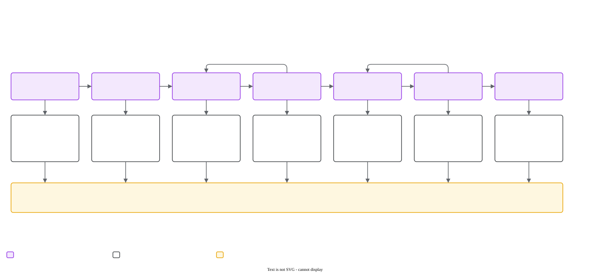

*Editable source: [`diagrams/src/04-campaign-lifecycle.drawio`](diagrams/src/04-campaign-lifecycle.drawio). Every workspace reads and writes the same evidence record, and a Fix or Rethink verdict sends the team back to Creative Studio.*

The demo brand is **Aamod**, a fictional festive-sweets brand. Its Diwali film was made in Marathi for Maharashtra, and the brief targets Tamil Nadu, Kerala and West Bengal. Open the live app, choose **Try the demo**, and follow the campaign:

1. **Campaign Desk.** Read the brief and Brand Kit. The glossary spells "Aamod" in five scripts and marks the tagline as never translated.
2. **Market Lens.** Open Tamil Nadu. Every claim shows source, date, kind, scope and confidence, and the Evidence Meter says how thin or solid the profile is. Two real source disagreements are in the data (West Bengal's Hindi share in the 2011 Census table against Wikipedia, and the day of Dahi Handi in Maharashtra); both values stay visible.
3. **Creative Studio.** X-Ray the film: scenes, keyframes, the Marathi transcript with an English back-translation, and the Maharashtrian references. Transcreate for Tamil Nadu, apply a Tweak Chip, lock the logo, tin and tagline, and see the Version Tree. The original is never changed.
4. **Audience Lab.** Run a Quick Read on a synthetic Tamil Nadu panel, then a Risk Check. It flags an unsubstantiated superiority claim in the end-card small print, pinned to the scene and the text box.
5. **Launch Room.** Compare the original and adapted versions under visible rules. The Readiness Board returns **Fix** until the claim is removed or substantiated.
6. **Live Pulse.** The regional dashboard on a sample dataset, real comments from the YouTube Data API, and Predicted vs Actual.
7. **Proof Vault.** Generate the Proof Report: findings, sources, conflicts, creative changes, synthetic audience results, risks, readiness, limitations and run metadata.

The Aamod imagery and voice are AI-generated (Gemini image and speech models) and all on-screen text is rendered in code. The Marathi voice-over was checked by a transcription round trip, not by a native speaker. Long jobs run in the background with a visible state, and an interrupted run can be retried.

## Features by workspace

Omnicult has 55 features across seven workspaces and a platform layer. On top of those sit the [Generate studio](#creative-generation) and real YouTube comments in Comment Pulse.

### Campaign Desk

| Feature | What it does |
|---|---|
| Today View | What is running, finished or failed, and which campaigns need attention |
| Campaign Brief | Product, objective, regions, languages, channels, budget, dates and success metric, entered once and read by every workspace |
| Brand Kit | Logo, colours, fonts, product images, tone, protected terms and never-change zones |
| Brand Glossary | Brand spellings by script, preferred translations, pronunciation and do-not-translate terms, checked in code after every adaptation |
| Command Bar | Type what you want done; it runs the same tools the workspaces use |
| Demo Mode | The Aamod campaign on recorded and offline datasets, kept apart from live records |

### Market Lens

| Feature | What it does |
|---|---|
| Culture Atlas | Cultural signals for a region, each traceable to its source |
| State Profile | Languages, scripts, festivals, food, colours, symbols, humour, family roles, customs and sensitivities for a state, every fact tagged |
| Language Map | Language and script mix by state, from the India reference data and Census 2011 mother-tongue counts |
| Moment Calendar | Public holidays and festivals that matter for timing |
| Market Compare | States side by side on the same evidence |
| Trend Radar | Public-interest trends by region from open data, shown as attention, not demand |
| Search Pulse | A state's top and rising Google searches of the latest week, with each term's weekly score, in the State Profile and the Trend Radar |
| State Facts | Official statistics for the state beside the all-India figure: literacy, urban share, phone and internet use, income per person and household spending, each with its period |
| Category Shelf | How the product category shows up regionally |
| Evidence Meter | Sources, supported claims, freshness, coverage, open conflicts and stale claims, rated weak, partial or solid by named thresholds |

### Creative Studio

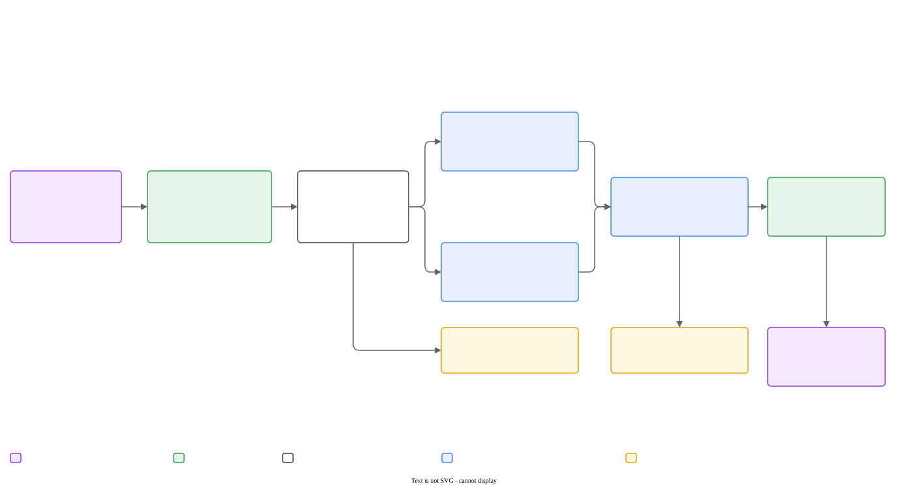

*Editable source: [`diagrams/src/08-creative-xray.drawio`](diagrams/src/08-creative-xray.drawio).*

| Feature | What it does |
|---|---|
| Creative X-Ray | Image, video (up to 60 s, 50 MB) or audio broken into scenes, keyframes, on-screen text, transcript, claims and cultural observations; transcription proven live |
| Transcreate | Regional copy with a literal English back-translation, the reason for each change, and code checks for script and glossary terms |
| Tone Dials | Formality, code-mixing, urban-rural, playfulness and energy, applied as explicit directives |
| Tweak Chips | Small structured changes, each with target, reason, supporting claims and expected effect |
| Lock and Edit | Locks on logos, products, packshots, taglines and text, enforced by the operation engine, not by the prompt |
| Version Tree | Every operation creates a new version with actor, reason and cost; restore and compare any two |
| Remake: Visuals | A regional key visual from the Gemini image model, with Indic text set in code and locked regions restored pixel for pixel |
| Remake: Sound | A regional voice-over from Gemini speech, confirmed before it runs |
| Remake: Video | A short regional cut with Veo, confirmed and budget-checked before it runs |
| Voice Director | Speak or type a direction; it is transcribed, turned into a typed plan on the same operations as the UI, and applied only after you confirm; proven live |
| Format Fit | Resize and recompose a version for each placement |
| Claim Guard | Checks product claims against what the brand can substantiate, with a human review step |
| Script Check | Checks regional text for the right script and shaping problems |

### Audience Lab

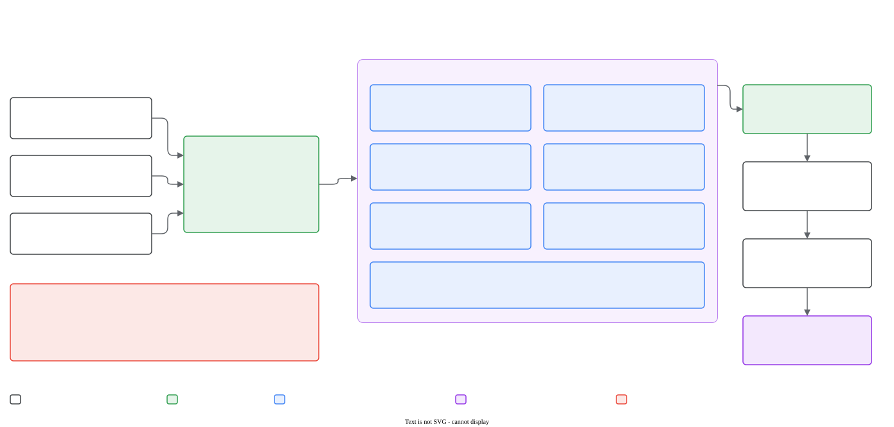

*Editable source: [`diagrams/src/09-audience-lab.drawio`](diagrams/src/09-audience-lab.drawio).*

| Feature | What it does |
|---|---|
| Quick Read | First reactions, message understanding, confusion and regional concerns from a small synthetic panel |
| Audience Study | A larger bounded panel sampled by state, language, city tier and age band |
| Ask the Panel | Follow-up questions to the same synthetic participants, with their memory kept |
| Live Focus Group | A moderated synthetic discussion you can interject into |
| Buzz Simulator | How talk about a message might spread through a synthetic network |
| Risk Check | Findings pinned to an image region or video moment, with cited ASCI advertising-code clauses and a severity computed by rules |
| Message Check | Whether the intended message survives adaptation |

### Launch Room

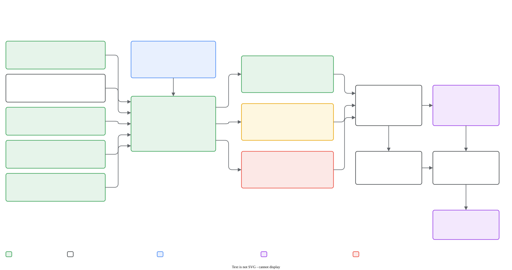

*Editable source: [`diagrams/src/10-launch-room-rules.drawio`](diagrams/src/10-launch-room-rules.drawio).*

| Feature | What it does |
|---|---|
| Compare and Score | Versions scored by fixed rules across clarity, brand fidelity, cultural relevance, sensitivity risk and objective fit |
| Readiness Board | Go, Fix or Rethink per region, with main reason, highest-priority issue, next action, open conflicts and confidence limits |
| Review Links | Expiring, revocable links for sign-off outside the team |
| Region Plan | Which version goes to which region |
| Asset Pack | Everything a region needs, bundled for download |

### Live Pulse

| Feature | What it does |
|---|---|
| Regional Dashboard | Delivery, cost, response, video and outcome by region and version, on a sample dataset, with last-updated time and provisional days marked |
| Alerts | Deterministic rules (CTR drop, cost spike) run daily by Cloud Scheduler |
| Comment Pulse | Languages detected, sentiment and themes for real comments fetched through the YouTube Data API |
| Fatigue Watch | Frequency up while response falls, per version and region |
| Weekly Digest | A weekly summary generated by Cloud Scheduler |
| Predicted vs Actual | Compares Lab predictions and Launch scores with Pulse results by rank agreement. On the sample dataset it demonstrates the method; it is not a calibration |

### Proof Vault

| Feature | What it does |
|---|---|
| Proof Report | Brief, regions, evidence, conflicts, creative versions, X-Ray and risk findings, transcreation, audience results, readiness, approvals, limitations and run metadata; exports to PDF |
| Evidence Map | Sources, claims, scenes, risks, versions and approvals as one connected map |
| Search | Find any claim, source, scene or decision |
| Run History | Every run with model, prompt version, estimated cost, latency and state |
| Data Health | Stale sources, thin coverage and open conflicts, listed |

### Platform

| Feature | What it does |
|---|---|
| Teams and Roles | Workspaces with owner, editor, reviewer and viewer roles, invites and an audit log, enforced on the server |
| Country Pack: India | All 36 states and union territories with their languages and scripts |
| Usage | Estimated AI spend by workspace and campaign, with run and daily budgets |
| Resumable Runs | Background runs with idempotent start; a restart marks in-flight runs as interrupted and they are safe to retry |
| Model Gateway | One gateway for every model call (see [AI and the model gateway](#ai-and-the-model-gateway)) |

## Creative generation

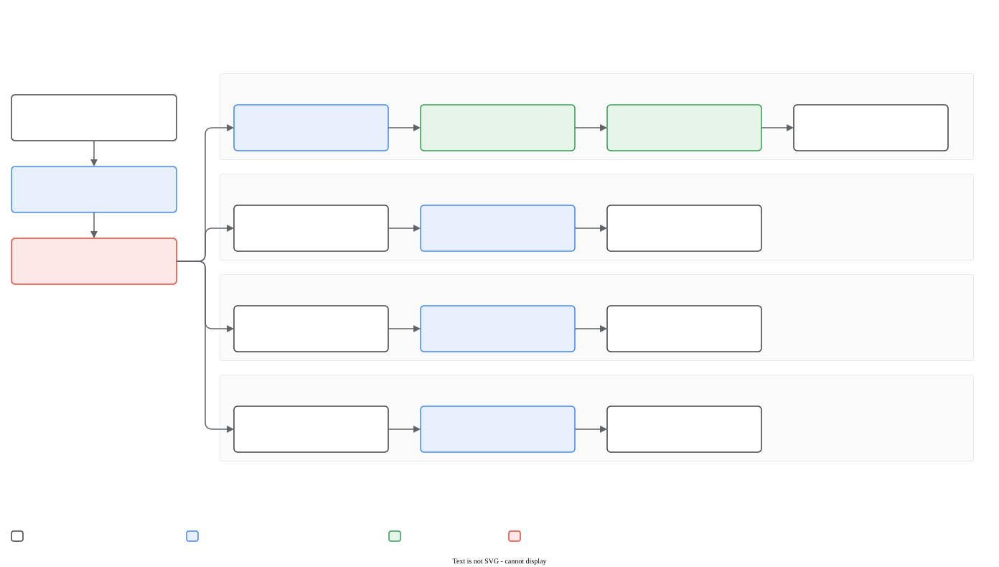

*Editable source: [`diagrams/src/07-creative-generation.drawio`](diagrams/src/07-creative-generation.drawio).*

Models draw, speak and compose. Code does everything that must be exact: it sets the text, restores the locked regions and records the run.

| Output | Model | What code guarantees |
|---|---|---|
| Key visual (Remake: Visuals) | Gemini image model, `gemini-3.1-flash-image`, location `global` | The model draws no text. Locked regions (logo, product, packshot, tagline) are restored pixel for pixel, and all Indic text is set in code with Pillow, libraqm and Noto fonts, so Tamil, Malayalam, Bengali and Devanagari are shaped correctly |
| Voice-over (Remake: Sound) | Gemini speech, `gemini-3.8-flash-tts` | One request per line, taken from the transcreated copy with its back-translation; the Marathi demo voice-over was checked by a transcription round trip |
| Jingle | Lyria, `lyria-002`, `us-central1` | A 30 s clip returned as a 48 kHz WAV |
| Short regional video (Remake: Video) | Veo | Confirmed and budget-checked before it runs |

**Generate studio.** The studio produces a key visual, an Indic voice-over, a Lyria jingle and a Veo clip from the campaign brief. Each one is a recorded run with its model, cost and prompt version, and can be sent to Creative Studio as a new version if you choose.

**Guardrails for every paid generation:**

- The user confirms the run first, and the gateway refuses it before sending if it would pass the per-run budget (USD 0.50) or the daily budget (USD 5.00).
- Output goes into the Version Tree as a new version with actor, reason and cost. The original is never changed.
- The imagery and audio are AI-generated, and exports and the UI say so.

Measured on Vertex AI: one Tamil Nadu key visual with Tamil text shaped correctly cost about USD 0.07 including 4 Tamil TTS lines, and a Lyria jingle was a 32.8 s 48 kHz WAV in 29 s.

## How Omnicult stays honest

- **Synthetic audiences are AI personas, not people.** They are model-written personas sampled by state, language, city tier and age band, never by protected traits. One model voices all of them, so agreement is not confirmation, and nothing here is calibrated against real outcomes.
- **Scores, verdicts and severities are computed by code.** Scoring is `mvp-2`, readiness is `ready-1`, risk severity is `risk-rules-v1`. Models supply observations; they never choose a score, a verdict or a confidence level.
- **Every claim has provenance:** source, date, kind (observed, calculated, synthetic, interpretation or unverified), scope and confidence. When sources disagree, both values stay visible and the conflict lowers dependent confidence until a reviewer resolves it.
- **Confidence is Low, Moderate or High, not a percentage.** Moderate needs two independent observed sources under two years old. High needs native-reviewer confirmation or real campaign results, and the team has no native reviewer, so no claim shows High. Synthetic results never exceed Moderate.
- **Demo data is documented here, not badged on screen.** The screens carry no demo or sample banners; [Demo data and sources](#demo-data-and-sources) says exactly what is recorded, generated or sample.
- **Not claimed:** legal clearance (Risk Check is a screening aid and the ASCI index is a partial set of cited excerpts), sales prediction, or native-quality translation. The Census figures are from 2011, and Wikipedia pageviews measure attention, not demand.
- **Failures are shown.** If a model call fails, Omnicult reports it and, where configured, falls back to another Google model and records that in the trace. It never switches to a non-Google provider.

## Architecture

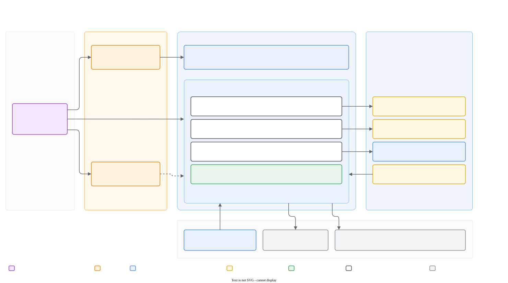

*Editable source: [`diagrams/src/01-system-architecture.drawio`](diagrams/src/01-system-architecture.drawio).*

- **Web** (`frontend/`): Next.js 16, React 19, TypeScript, Tailwind CSS 4, shadcn/ui on Base UI, TanStack Query and a typed `openapi-fetch` client generated from `contracts/openapi.json`. The browser receives only `NEXT_PUBLIC_*` values and never calls a model.
- **API** (`backend/`): FastAPI on Python 3.13 (the project supports 3.12 and newer), Pydantic, async SQLAlchemy, Alembic and LangGraph. Every workflow is a graph of named stages; each stage either calls the gateway or runs deterministic code and records a trace.
- **Models write language; code does the rest.** Resolution rules, confidence, conflicts, scoring, readiness, risk severity, script checks, glossary checks, alert rules and report assembly are deterministic. Model output and retrieved text are treated as untrusted and validated against strict schemas.
- **Runs** execute inside the API process, so the API runs as a single instance with CPU always allocated. A restart marks in-flight runs as interrupted, and starting a run twice with the same `Idempotency-Key` returns the run that already exists.
- **Contract first.** `contracts/openapi.json` is generated from the API, the web client is generated from it, and CI fails if the committed file is out of date.

## Google Cloud and Firebase services used

| Service | What it does in Omnicult |
|---|---|
| **Vertex AI, Gemini text models** | Structured text for X-Ray, Transcreate, Tweak Chips, Quick Read, Risk Check and reports; vision on video keyframes; Google Search grounding for cited research; transcription of uploads and spoken directions |
| **Vertex AI, Gemini embeddings** | 768-dimension embeddings for search |
| **Gemini image model** | Regional key visuals, with Indic text set in code and locked regions restored |
| **Gemini TTS** | Indic voice-over, one line per request |
| **Lyria** | Regional jingles as 48 kHz WAV |
| **Veo** | Short regional video cuts |
| **Firebase Authentication** | Google sign-in, email and password, and anonymous sessions for the demo; ID tokens verified in the API |
| **Firebase Hosting** | Public entry point at `omnicult-app.web.app`, rewriting every path to the web service |
| **Cloud Run** | `omnicult-api`, `omnicult-web`, and the `omnicult-migrate` and `omnicult-seed` jobs, in `asia-south1` |
| **Cloud SQL for PostgreSQL** | The primary database (`omnicult-db`) |
| **Cloud Storage** | Uploaded creatives, derived keyframes, generated media and report exports, served through short-lived signed URLs |
| **Secret Manager** | The database URL, the YouTube API key and the data.gov.in API key |
| **Cloud Scheduler** | Daily alert evaluation, the weekly digest and the daily refresh of Search Pulse and State Facts, calling OIDC-protected internal endpoints |
| **BigQuery** | Search Pulse reads Google's public Trends dataset with one capped query a day, inside the free tier |
| **Cloud Build and Artifact Registry** | Container builds and images for the API and the web app |
| **YouTube Data API** | Real comments for Comment Pulse |

## AI and the model gateway

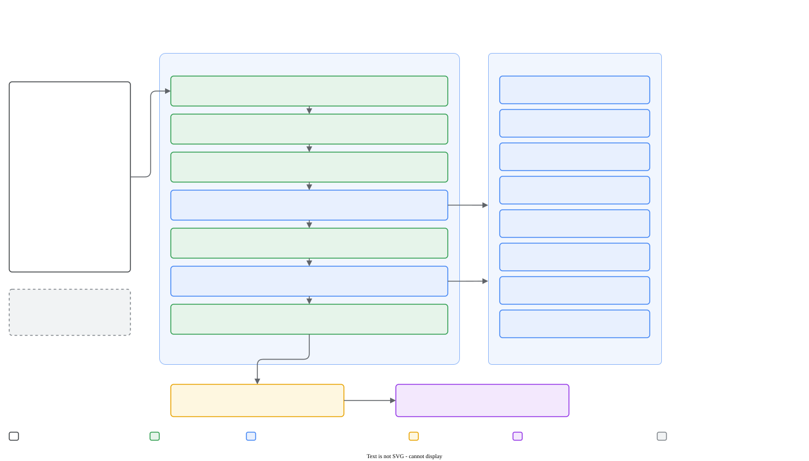

*Editable source: [`diagrams/src/06-model-gateway.drawio`](diagrams/src/06-model-gateway.drawio).*

All model calls go through one gateway (`backend/app/llm/gateway.py`). Model ids are configuration (`GEMINI_MODEL_*`); the capability registry (`backend/app/llm/registry.py`) knows what each id can do and what it costs. Defaults, checked against Vertex AI on 17 November 2026:

| Work | Default model |
|---|---|
| Fast text: X-Ray scene structuring, panel interviews | `gemini-3.5-flash-lite` |
| Default text: Transcreate, Tweak Chips, Quick Read, analysis, vision, grounding, transcription | `gemini-3.8-flash` |
| Reasoning: Risk Check (falls back to the default tier if it fails) | `gemini-4-argon` |
| Embeddings, 768 dimensions | `gemini-embedding-2` |
| Image generation (location `global`) | `gemini-3.1-flash-image` |
| Speech | `gemini-3.8-flash-tts` |
| Music | `lyria-002` (`us-central1`) |
| Video | Veo |

- **Routing.** Each agent names a task class; `routing-v2` maps it to a fast, default or reasoning tier and then to a configured Gemini model. Capability adapters cover embeddings, vision, image generation, speech, music, grounded research and transcription.
- **Structured output.** Every important call has a Pydantic schema and a `prompt_version` (for example `xray-scenes-v1`, `transcreate-lines-v1`, `tweak-chips-v1`, `quick-read-v1`, `risk-check-v1`). Output is validated, given one repair attempt, and otherwise raised as an error distinct from a provider failure. Invalid output never reaches the database as trusted data.
- **Bounds.** Timeouts, bounded retries for transient errors, and an approved fallback to a lower Google tier that is recorded in the trace.
- **Budgets and metering.** Each request records provider, model, prompt version, tokens, estimated cost and latency in `ai_usage_events`. A call that would pass the per-run budget (default USD 0.50) or the daily budget (default USD 5.00) is refused before it is sent. Costs are estimates from a versioned price table, not invoices.
- **Safety.** Source text is wrapped as untrusted data, and a content-filter block is reported as its own error. Prompts and outputs are not logged.
- **Demo.** Demo workspaces use a fixture provider with no network call.

## Evidence and open data

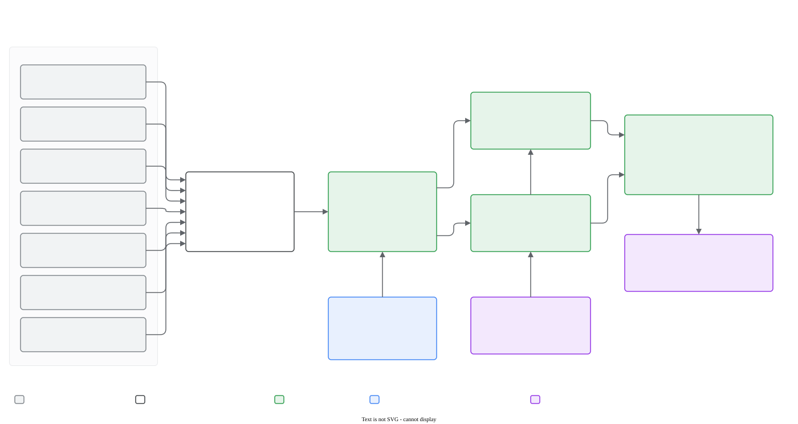

*Editable source: [`diagrams/src/05-evidence-pipeline.drawio`](diagrams/src/05-evidence-pipeline.drawio).*

Open sources become cited **claims**. Code then decides confidence, finds conflicts and rates each region with the Evidence Meter. A Gemini interpretation can be stored, but it is labelled as an interpretation and never sets a confidence.

| Source | Used for | Licence or terms |
|---|---|---|
| Wikidata | Entity resolution, region and language facts | CC0 |
| Wikipedia text | Short cited excerpts as supporting evidence | CC BY-SA 4.0; page URL and title kept as attribution |
| Google Trends public dataset (BigQuery) | Search Pulse: the top and rising search terms and weekly scores for every state, as the dataset reports them | Google dataset `bigquery-public-data.google_trends`, read through the BigQuery free tier |
| data.gov.in (Open Government Data Platform India) | State Facts: NFHS-5, TRAI teledensity and internet subscriptions, net state domestic product per person, household consumption expenditure 2023-24, and Census 2011 literacy and urban share | Government Open Data License - India; the resource id and the source's update date are kept with every figure |
| Wikipedia pageviews | Attention trends in the regional and English editions | Wikimedia analytics data; aggregate counts, attributed |
| Census of India 2011, table C-16 | Mother-tongue counts and shares | Published by the Registrar General; only counts are stored, cited to the source |
| python-holidays | Public holidays by state | MIT |
| ASCI Code and guidelines | Cited clauses for Risk Check | Published by ASCI; short exact excerpts with page URL, partial index, not legal advice |
| State tourism and government pages | Short cited excerpts for festivals, food and customs | Each site's own terms |
| Noto Sans fonts | Rendering Indic text in code | SIL Open Font License 1.1 |

**Search Pulse data.** `international_top_terms` and `international_top_rising_terms` hold, per refresh date, the current top 25 terms and their rank, a 0 to 100 `score` per state and week (empty where Google reports none) and, for rising terms, `percent_gain`. Within one refresh the term list and ranks are the same for every state; the score is what differs by state and week. Omnicult stores the newest 12 weeks per state and shows ranks, scores and gains unchanged; "scored in N of 12 weeks" counts the weeks with a score. One query a day (about 0.74 GB, capped at 2 GB) serves every state; the dataset has no Ladakh or merged Dadra and Nagar Haveli and Daman and Diu, and uses `IN-CT`, `IN-OR` and `IN-TG` for Chhattisgarh, Odisha and Telangana. Demo mode reads a recorded snapshot of the four demo states and never queries BigQuery.

**State Facts data.** Seven data.gov.in resources are pulled with filters and field selection and stored per state with the source's own update date. A check costs one small request per resource and downloads only what changed; a stored copy counts as current for 7 days (TRAI, income, spending) or 30 days (NFHS-5, Census). data.gov.in answers 403 to every request from Google Cloud addresses (checked from Cloud Run on 19 Nov 2026), so the deployed service does not pull it: `python -m scripts.record_state_facts --all`, run from an Indian connection, records every state, and the seed job (`scripts/seed_state_facts.py`) loads that recording with the same parsing and upsert code as a live pull. Local runs with `DATA_GOV_IN_API_KEY` pull live. Census 2011 figures are not given to states whose territory has changed since (Andhra Pradesh, Telangana, Jammu and Kashmir, Ladakh, and Dadra and Nagar Haveli and Daman and Diu). No published resource gives TV, newspaper or radio reach by state, so the panel does not show media reach. Demo mode reads records captured from the live API on 19 Nov 2026.

**Keeping the public data current.** One Cloud Scheduler job calls an OIDC-protected endpoint at 05:30 IST every day. It refreshes Search Pulse, and State Facts wherever a data.gov.in key is configured; both refreshes are idempotent, and a failure makes the call fail so the scheduler retries. In the deployed service State Facts are updated by re-recording (the sources publish yearly or quarterly). Screens read the stored copy, so a slow or failing upstream never blocks a page.

Source coverage is uneven by design and reported as such: the curated references cover the four demo states, Wikidata is rate-limited and sparse for some regions, and a region with little evidence is shown as weak. Measured: a live Market Lens build of Tamil Nadu took 10 s.

## Demo data and sources

The screens do not label data as demo, sample or synthetic, so this section is where that is written down.

**The "Try the demo" project** (fictional brand Aamod) runs on recorded and offline datasets and calls no model:

- recorded Wikidata entity searches and Wikipedia pageview recordings;
- a generated trend series, which is not real pageviews;
- a sample Live Pulse dataset and sample comments;
- recorded snapshots of Search Pulse (Google Trends in BigQuery) and State Facts (data.gov.in) for the four demo states;
- synthetic audience panels: AI personas, not people;
- pre-made fixture outputs for the AI steps, so the demo calls no model.

**Live projects** read live sources (Vertex AI, Wikidata, Wikipedia, the YouTube Data API, Google Trends in BigQuery and data.gov.in) and record provenance on every claim and run: source, retrieval time, model, prompt version and cost where known.

**Proof Vault keeps that provenance.** Each claim's evidence record, each run's stage trace and the Data Health view carry the data mode (`mode`, `retrieval_mode`), so a result can always be traced back to what produced it.

## Data model

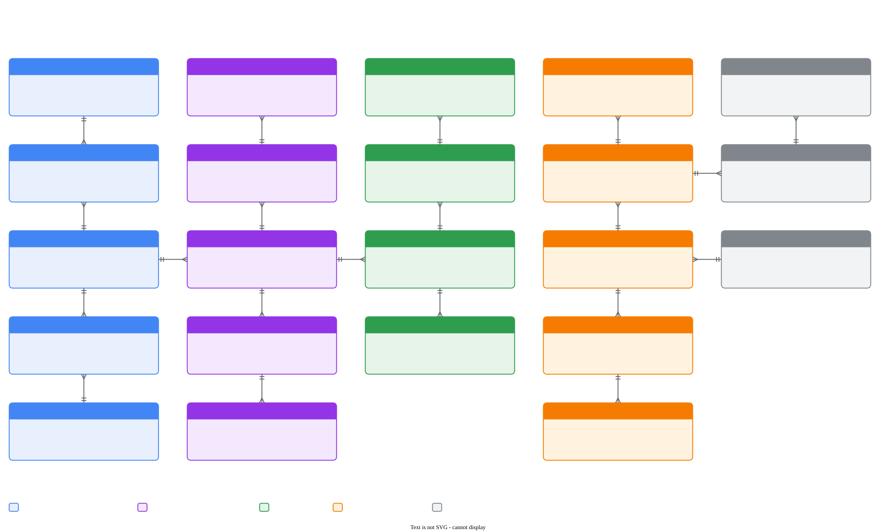

*Editable source: [`diagrams/src/11-database-er.drawio`](diagrams/src/11-database-er.drawio). Main tables only.*

The hierarchy is **workspace** (the tenant) > **project** (one brand effort, with its Brand Kit and glossary) > **campaign** > **version nodes** (the Version Tree). Tables fall into these groups, all created by additive Alembic migrations in `backend/migrations/versions/`:

| Area | Tables |
|---|---|
| Identity and tenancy | `users`, `workspaces`, `workspace_members`, `audit_log` |
| Reference data | `languages`, `regions`, `country_packs`, `region_language_profiles`, `regional_moments` |
| Evidence | `claims`, `claim_sources`, `conflicts`, `conflict_resolutions` |
| Creative | `assets`, `creative_assets`, `creative_scenes`, `version_nodes`, `operations`, `locks`, `chips`, `glossary_terms` |
| Audience and launch | `audience_runs`, `audience_participants`, `audience_questions`, `audience_answers`, `audience_risk_findings`, `readiness_verdicts`, `approvals` |
| Pulse and proof | `metric_series`, `proof_reports`, `proof_report_exports` |
| Runs and metering | `agent_runs`, `ai_usage_events`, `embeddings` |

Workspace membership is checked on every request: a non-member gets 404, a member with too little role gets 403. Composite foreign keys (for example `campaign_id` with `project_id`) keep a child row from pointing at another project. Authorization lives in the API, which connects as the table owner.

## Authentication and roles

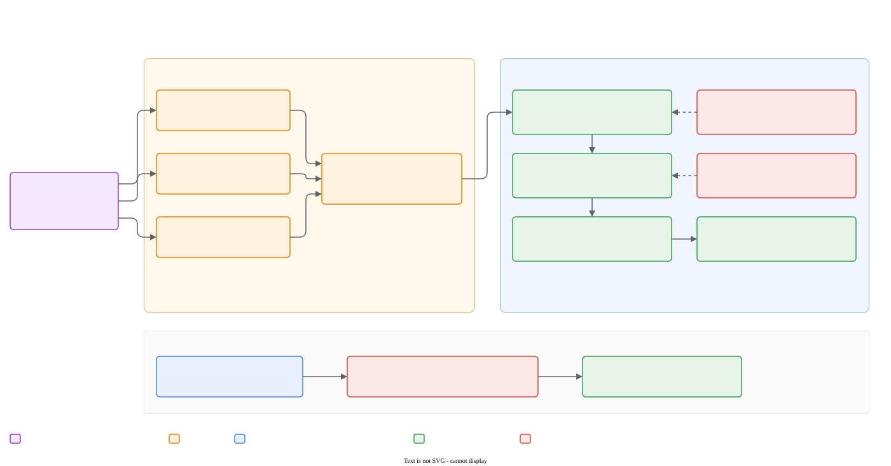

*Editable source: [`diagrams/src/03-authentication.drawio`](diagrams/src/03-authentication.drawio).*

- **Sign-in:** Firebase Authentication with Google, email and password, and anonymous sessions (Try the demo). The browser holds the Firebase session and sends the ID token as `Authorization: Bearer` on every API request.
- **Verification:** the API checks the token's signature (RS256), issuer, audience and expiry, then finds or creates the user. The first sign-in bootstraps the user's first workspace (`GET /me`).
- **Roles:** every workspace member is an owner, editor, reviewer or viewer, and the API checks the role for each operation. Invites and an audit log are part of the platform.
- **Anonymous demo users** can explore the seeded demo but cannot create live projects (the API answers 403).
- **Development mode:** with `AUTH_MODE=dev` a bearer token `dev-<label>` maps to a stable test user. The settings loader refuses it when `APP_ENV=production`.
- **Scheduled jobs** call internal endpoints with an OIDC token from the `omnicult-scheduler` service account; the API checks the caller and the audience.
- **Review links** give people outside the team a way to sign off; they expire and can be revoked.

## Security and privacy

- Secrets are environment variables or Secret Manager entries. There is no key file: Cloud Run uses its service account through Application Default Credentials. The browser gets only public Firebase identifiers and the API URL.
- Firebase ID tokens are verified in the API. The development auth mode is refused when `APP_ENV=production`, and production start-up also requires PostgreSQL and explicit CORS origins.
- Authorization is enforced on the server for every request, never by the frontend alone. A non-member gets 404, and a second user cannot read the first user's project (the smoke test checks this against the live deployment).
- Uploads are typed by magic bytes, size- and duration-limited, probed with ffprobe before storage, and require a rights confirmation for video and audio. Emails and phone numbers are redacted from sidecar text and metadata before any model sees them.
- Synthetic participants are built from aggregate dimensions only; protected traits (religion, caste, health, gender and similar) are refused as sampling dimensions.
- Source text, retrieved pages and model output are untrusted data. Instructions embedded in them cannot change prompts or grant tool permissions, and model output is validated against strict schemas.
- The Cloud Storage bucket has uniform access and enforced public-access prevention; media is served through signed URLs that expire.
- Request models reject unknown fields, errors use one envelope without stack traces, and interactive API docs are off in production.
- Spend is capped in code by the AI budgets, and prompts and model outputs are not logged.
- Gitleaks runs in CI. The app has not had an independent security audit, and Firebase token revocation is not checked (tokens last one hour).

## Run it locally

Prerequisites: [uv](https://docs.astral.sh/uv/) (installs the pinned Python 3.13), Node.js 22 or newer, and ffmpeg with ffprobe on `PATH` for video and audio. Indic text rendering needs libraqm (with FriBiDi); the Linux image has it, and on a machine without it Latin text renders and Indic text is refused rather than drawn unshaped.

**API**

```bash
cd backend
cp .env.example .env                       # SQLite, AUTH_MODE=dev, no cloud credentials
uv sync
uv run alembic upgrade head
uv run python -m scripts.seed_reference_data
uv run uvicorn app.main:app --reload --port 8000
```

**Web app**

```bash
cd frontend
cp .env.example .env.local                 # API at http://localhost:8000, NEXT_PUBLIC_AUTH_MODE=dev
npm ci
npm run dev                                # http://localhost:3000
```

With `AUTH_MODE=dev` no sign-in is needed. Demo workspaces run on fixtures and need no Google credentials. For live runs, set `GOOGLE_CLOUD_PROJECT` and sign in with `gcloud auth application-default login`; live runs spend Vertex AI credit within the budgets below.

After changing an API schema, run `uv run python -m scripts.export_openapi` in `backend/` and `npm run gen:api` in `frontend/`.

## Environment variables

Full lists are in `backend/.env.example` and `frontend/.env.example`. All settings are Google and Firebase settings or application limits; there is no key file.

**Backend**

| Variable | Purpose |
|---|---|
| `APP_ENV`, `AUTH_MODE`, `FIREBASE_PROJECT_ID` | Environment and authentication (`dev` or `firebase`) |
| `DATABASE_URL` | SQLite locally, PostgreSQL in production |
| `FRONTEND_ORIGINS` | CORS allow-list |
| `GOOGLE_GENAI_BACKEND` | `vertex` (default) or `gemini_api` (development and fallback only; never use it with real brand data) |
| `GOOGLE_CLOUD_PROJECT`, `GOOGLE_CLOUD_LOCATION` | Vertex AI access (`global` for text and image models) |
| `GEMINI_API_KEY` | Only for `GOOGLE_GENAI_BACKEND=gemini_api` |
| `GEMINI_MODEL_FAST`, `_DEFAULT`, `_REASONING`, `_IMAGE`, `_TTS`, `_LIVE`, `_MUSIC` | Model ids by tier and capability; blank means the default |
| `GEMINI_EMBEDDING_MODEL`, `GEMINI_EMBEDDING_DIMENSIONS` | Embeddings (768 dimensions) |
| `AI_RUN_BUDGET_USD`, `AI_DAILY_BUDGET_USD` | Estimated-cost ceilings (defaults 0.50 and 5.00) |
| `LLM_REQUEST_TIMEOUT_SECONDS`, `LLM_MAX_RETRIES` | Gateway bounds |
| `ASSET_STORAGE_BACKEND`, `GCS_BUCKET` | `database` (local and tests), `local` or `gcs` with its bucket |
| `YOUTUBE_API_KEY` | Comment Pulse |
| `DATA_GOV_IN_API_KEY` | State Facts (data.gov.in); without it live State Facts answer 503 |
| `BIGQUERY_PROJECT` | Project that runs the Search Pulse query jobs; falls back to `GOOGLE_CLOUD_PROJECT` |
| `SCHEDULER_SERVICE_ACCOUNT`, `SCHEDULER_AUDIENCE` | Who may call the internal endpoints |
| `WIKIMEDIA_USER_AGENT` | Contact string Wikimedia asks API clients to send |
| `MAX_MEDIA_BYTES`, `MAX_MEDIA_SECONDS`, `FFMPEG_PATH`, `FFPROBE_PATH` | Upload limits (50 MB, 60 s) and media tools |

**Frontend** (only `NEXT_PUBLIC_*` reaches the browser; none is a secret)

| Variable | Purpose |
|---|---|
| `NEXT_PUBLIC_API_BASE_URL` | The API origin |
| `NEXT_PUBLIC_AUTH_MODE` | `dev` (local only) or `firebase` |
| `NEXT_PUBLIC_FIREBASE_API_KEY`, `_AUTH_DOMAIN`, `_PROJECT_ID`, `_APP_ID` | Public Firebase web app identifiers |
| `NEXT_PUBLIC_API_MOCK` | `1` serves `contracts/fixtures` through a development mock (ignored in production builds) |

## Database migrations

Schema changes are additive Alembic migrations in `backend/migrations/versions/` (currently 0001 to 0034).

```bash
cd backend
uv run alembic upgrade head                # local SQLite or any PostgreSQL in DATABASE_URL
```

On Google Cloud, `ops/deploy/migrate.ps1` creates or updates two Cloud Run jobs from the API image and runs them in order:

| Job | What it runs |
|---|---|
| `omnicult-migrate` | `alembic upgrade head` (additive, safe to re-run) |
| `omnicult-seed` | `python -m scripts.seed_all`: India languages, regions, language profiles, curated moments and the country pack (idempotent upserts) |

Both connect through the Cloud SQL attachment with `DATABASE_URL` from Secret Manager. Take a backup before a risky migration with `.\ops\deploy\migrate.ps1 -Backup`; `-SkipSeed` runs the schema only. The ASCI index ships inside the API image, and the Live Pulse sample data is generated in code, so neither needs a seed step.

## Deployment

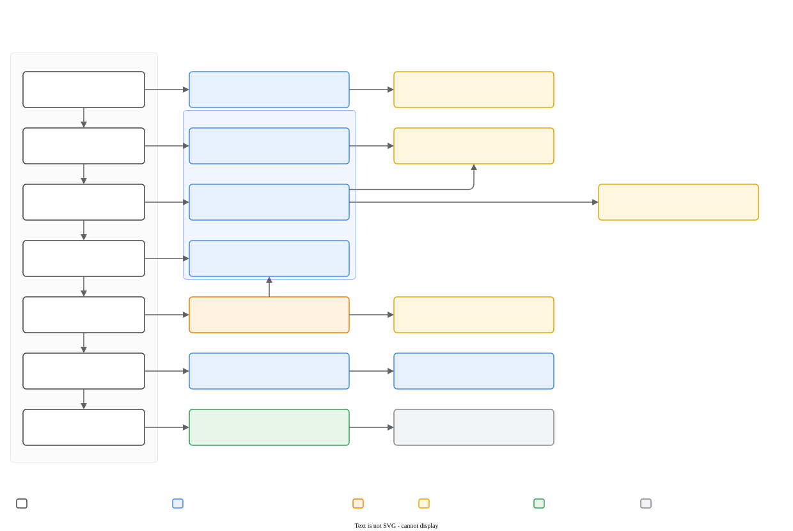

*Editable source: [`diagrams/src/02-deployment.drawio`](diagrams/src/02-deployment.drawio).*

Deployment scripts for Google Cloud are in `ops/deploy/` (PowerShell). The region is `asia-south1`; Vertex AI image models are reached at `global` and Lyria at `us-central1`. Run them in this order:

```powershell
.\ops\deploy\build.ps1 -Target all     # 1  Cloud Build -> Artifact Registry (api and web images)
.\ops\deploy\migrate.ps1               # 2  Cloud Run jobs: alembic upgrade head, then seed reference data
.\ops\deploy\deploy-api.ps1 -Public    # 3  Cloud Run, AUTH_MODE=firebase, APP_ENV=production
.\ops\deploy\deploy-web.ps1            # 4  Cloud Run, Firebase config inlined at build time
.\ops\deploy\deploy-hosting.ps1        # 5  Firebase Hosting in front of the web service
.\ops\deploy\scheduler.ps1             # 6  alerts, weekly digest and daily data refresh jobs
.\ops\deploy\smoke.ps1                 # 7  live checks of the API, web app and sign-in flow
```

`ops/deploy/secrets.ps1` creates the YouTube API key secret once, before step 3.

- `omnicult-api` runs with one instance and CPU always allocated, because runs execute in the process. It connects to Cloud SQL through the Cloud Run attachment, and the database URL comes from Secret Manager.
- The web app's `NEXT_PUBLIC_*` values are build-time, so a changed API URL needs a web rebuild (`build.ps1 -Target web`).
- Google sign-in is enabled once in the Firebase console; email and anonymous sign-in are enabled by script.
- `smoke.ps1` checks `/health` and `/ready`, that API docs are off and a token-less request is 401, that a development token is refused in production, CORS from the web origin, the landing, app and sign-in pages, an anonymous sign-in with a demo project, and that a second user cannot read the first user's project. It cleans up the demo project and the anonymous users it created.
- Spend is capped in code by the AI budgets, and a Cloud Billing budget sends alerts.

## Tests

The default backend run is hermetic: SQLite, fixture providers and no paid API call.

```bash
cd backend
uv run pytest -q                                   # unit, API, contract, security, integration
uv run python -m scripts.export_openapi            # then: git diff --exit-code ../contracts/openapi.json
TEST_POSTGRES_URL=postgresql+asyncpg://postgres@127.0.0.1:5432/postgres uv run pytest -q -m postgres tests/postgres

cd ../frontend
npm run typecheck && npm run lint && npm run build

cd ../e2e
npm ci && npx playwright test                      # set E2E_BASE_URL (default http://localhost:3001) to a running web app
```

Measured on 19 Nov 2026: **backend 1823 passed, 3 skipped, 0 failed**; frontend typecheck, lint and production build pass.

The suites cover confidence and conflict rules, scoring, readiness and risk rules, the operation engine and locks, culture adapters on recorded responses, media and Indic text rendering, proof assembly, authorization and tenancy, prompt-injection and secret hygiene, upload limits, and Alembic migrations on PostgreSQL. GitHub Actions runs the backend suite, a PostgreSQL 17 job, the frontend checks and a secret scan. Live Vertex AI checks are opt-in (`scripts/verify_google_models.py --run`).

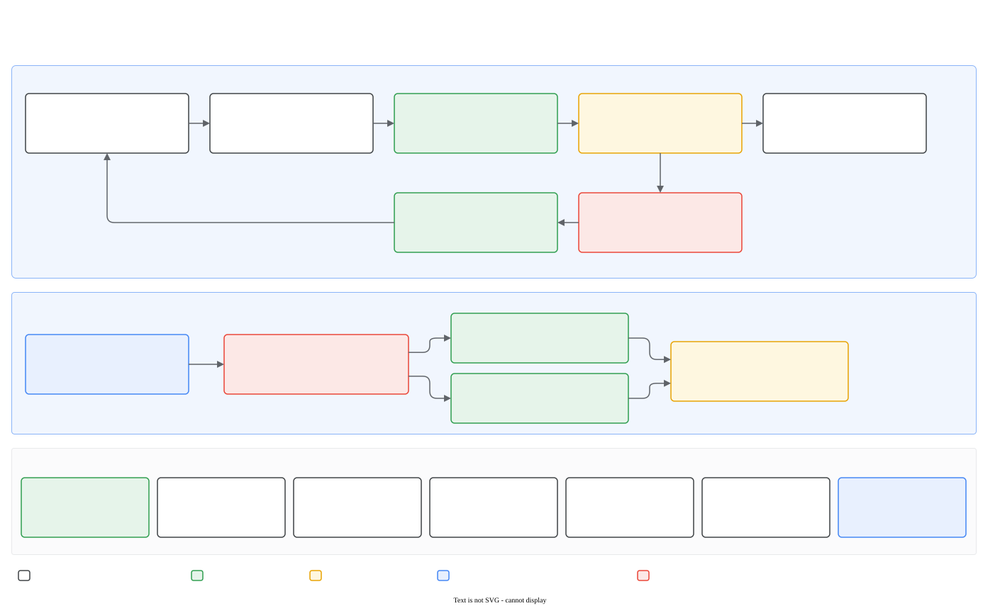

*Editable source: [`diagrams/src/12-runs-scheduler-testing.drawio`](diagrams/src/12-runs-scheduler-testing.drawio). Runs are resumable and idempotent; the Cloud Scheduler jobs authenticate with OIDC.*

## Repository layout

```text
backend/     FastAPI service (uv project): app/ (api, services, workflows, agents, analytics, llm, integrations, media, studio),
             migrations/, scripts/, tests/
frontend/    Next.js app: src/app (routes), src/features (workspaces), src/components, src/lib
contracts/   openapi.json (generated) and fixtures/
e2e/         Playwright end-to-end tests
ops/         Cloud Build configs, deploy scripts, Firebase and Cloud Storage configuration
diagrams/    draw.io sources (src/), SVG (svg/) and PNG (png/) exports
scripts/     export-diagrams.ps1
.github/     CI workflow
```

## Acknowledgments and licence

Cultural data comes from the open sources listed in [Evidence and open data](#evidence-and-open-data): Wikidata, Wikipedia and Wikimedia pageviews, the Census of India, data.gov.in (Government Open Data License - India), Google's public Trends dataset, python-holidays and the ASCI Code. Indic text is set in Noto Sans (SIL Open Font License 1.1); the interface uses Eczar, Archivo and JetBrains Mono. The AI runs on Google Cloud: Vertex AI (Gemini, Lyria, Veo), Firebase, Cloud Run, Cloud SQL, Cloud Storage, Secret Manager, Cloud Scheduler, BigQuery and the YouTube Data API.

Released under the MIT licence. See [LICENSE](LICENSE).
